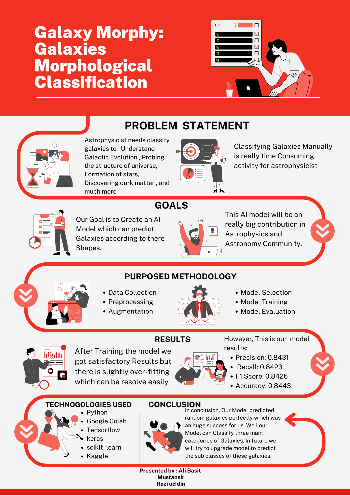

# Galaxy Morphological Classification

> A convolutional neural network that classifies galaxies into **Spiral**, **Elliptical**, and **Lenticular** types from telescope images — automating a task astronomers traditionally do by hand.

[](https://www.python.org/)
[](https://www.tensorflow.org/)
[](LICENSE)
[](notebooks/galaxy_classification.ipynb)

<p align="center">
  
</p>

---

## Overview

Galaxy morphological classification is the process of grouping galaxies by their **shape and structure**. These shapes carry deep physical meaning — they help astrophysicists study:

- **Galactic evolution** — how galaxies form and change over time
- **The large-scale structure of the universe**
- **Star formation** history and rates
- **Cosmic evolution** and the role of **dark matter**

Doing this by hand is slow and labour-intensive. This project trains a **Convolutional Neural Network (CNN)** to classify galaxies automatically into the three main morphological types:

| Type | Description |
|------|-------------|
| **Spiral** | Rotating disks with spiral arms |
| **Elliptical** | Smooth, featureless ellipsoids |
| **Lenticular** | Disk galaxies without prominent spiral arms (between spiral and elliptical) |

---

## Dataset

- **Source:** [Galaxy Zoo](https://www.kaggle.com/c/galaxy-zoo-the-galaxy-challenge) (Kaggle)
- The raw labels were **cleaned and filtered** down to the three main galaxy types (this step requires domain knowledge of galaxy morphology).
- **Data augmentation** was applied to expand the training set and improve generalisation.

> **Note:** The dataset is not included in this repository due to its size. Download it from the link above and place it in a `data/` folder before running the notebook.

---

## Method

1. **Data cleaning & label filtering** — isolate Spiral, Elliptical, and Lenticular classes.
2. **Exploratory Data Analysis (EDA)** — understand class balance and image characteristics.
3. **Data augmentation** — rotations, flips, and shifts to enlarge the training set.
4. **CNN built from scratch** — a custom convolutional architecture (no transfer learning).

**Training configuration:**

| Setting | Value |
|---------|-------|
| Loss function | Categorical Cross-Entropy |
| Optimizer | Adam |
| Metric | Accuracy |
| Epochs | 100 |

---

## Results

The model achieved **~84% accuracy** on the classification task.

> _Tip: Add your confusion matrix and accuracy/loss curves here — export them from the notebook into `assets/` and embed them like the poster above._

---

## Getting Started

### Prerequisites

- Python 3.9+
- (Recommended) a GPU for faster training

### Installation

```bash
# Clone the repository
git clone https://github.com/MuziSan07/Galaxy-Morphological-Classification.git
cd Galaxy-Morphological-Classification

# (Optional) create a virtual environment
python -m venv venv
source venv/bin/activate        # On Windows: venv\Scripts\activate

# Install dependencies
pip install -r requirements.txt
```

1. Download the [Galaxy Zoo dataset](https://www.kaggle.com/c/galaxy-zoo-the-galaxy-challenge) and place it in a `data/` folder.

**Option A — Jupyter notebook** (interactive, with inline plots):

```bash
jupyter notebook notebooks/galaxy_classification.ipynb
```

**Option B — Python script** (the same pipeline, version-controllable):

```bash
python src/galaxy_classification.py
```

> The script in `src/` is exported from the notebook. Review the data paths at the top before running — the original notebook was developed on Google Colab, so adjust the paths to your local `data/` folder.

---

## Project Structure

```
Galaxy-Morphological-Classification/
├── src/
│   └── galaxy_classification.py      # Python script version of the pipeline
├── notebooks/
│   └── galaxy_classification.ipynb   # Full pipeline: EDA -> augmentation -> CNN -> evaluation
├── assets/
│   ├── poster.png                    # Project poster
│   └── intro_video.mp4               # Short introduction video
├── requirements.txt                  # Python dependencies
├── LICENSE                           # MIT License
└── README.md
```

---

## Future Work

- Extend the classifier to **more galaxy sub-types** (irregular, barred spiral, etc.).
- Experiment with **transfer learning** (ResNet, EfficientNet) to push accuracy higher.
- Add **model evaluation visuals** (confusion matrix, per-class precision/recall).
- Package the trained model behind a simple **web demo** for live predictions.

---

## Contributing

Contributions, issues, and feature requests are welcome. Feel free to open an issue or submit a pull request.

## License

This project is licensed under the MIT License — see the [LICENSE](LICENSE) file for details.

## Acknowledgements

- [Galaxy Zoo](https://www.galaxyzoo.org/) and the Kaggle community for the dataset.
- The astrophysics and open-source AI communities.
